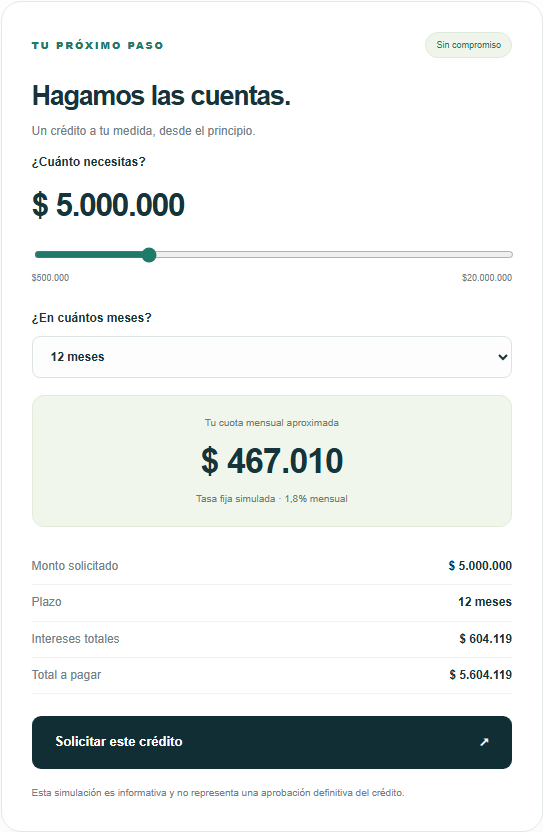

# FINTECH

Prototipo académico de créditos digitales. Permite estimar una cuota en pesos colombianos, solicitar un préstamo, revisar el resultado de una evaluación simulada y seguir el crédito desde la aceptación hasta el pago de las cuotas. El administrador puede consultar indicadores y revisar solicitudes desde su propio panel.

El equipo está conformado por **José Aldana, Miguel Macea, María Sáenz, Jairo Cepeda y Jenaro Augusto Hernández Padilla**.

## Cómo abrir el proyecto

1. Descarga el repositorio o clónalo con Git.

   ```sh
   git clone https://github.com/jaas1122/FINTECH.git
   cd FINTECH
   ```

2. Abre la carpeta en Visual Studio Code y ejecuta `index.html` con **Live Server**. También puedes servir la carpeta con Python 3.

   ```sh
   python -m http.server 8000 --bind 127.0.0.1
   ```

   En ese caso, visita [http://localhost:8000](http://localhost:8000). Usa **localhost** o HTTPS para que Web Crypto esté disponible. Mantén la misma dirección y puerto si quieres conservar el estado de la demostración.

El frontend usa HTML, CSS y JavaScript sin npm ni backend. Las fuentes externas son opcionales.

## Cuentas de demostración

| Rol | Correo ficticio | Contraseña de demostración |
| --- | --- | --- |
| Cliente | `cliente@fintech.com` | `Cliente123*` |
| Administrador | `admin@fintech.com` | `Admin123*` |

Al abrir la aplicación por primera vez se crean estas cuentas, un crédito desembolsado con cuatro cuotas pagadas y una solicitud en revisión. El botón **Usar cuenta de cliente** completa los datos del primer acceso. También puedes registrar una cuenta nueva con datos ficticios.

## Recorrido del cliente y del administrador

1. En Inicio, elige **Simular crédito**. Selecciona un monto de $500.000 a $20.000.000 COP y un plazo de 3, 6, 12, 18, 24 o 36 meses. La pantalla actualiza la cuota y el total estimados con una tasa ilustrativa del **1,8 % mensual**.
2. Inicia sesión como cliente y elige **Solicitar préstamo**. Completa la información personal y financiera, indica el monto y el plazo y revisa los datos en el cuarto paso. Envía la solicitud y consulta el puntaje de evaluación simulado.
3. Si la solicitud queda aprobada, elige **Ver y aceptar crédito** y confirma con **Aceptar préstamo**. En **Mis préstamos**, elige **Simular desembolso** y confirma.
4. En el crédito desembolsado, elige **Pagar cuota**, selecciona un método simulado como PSE y confirma. Consulta las cuotas pagadas, el saldo de capital y el plan de pagos.
5. Cierra sesión e ingresa como administrador. En **Administración**, filtra por **En revisión**, abre **Ver**, elige una decisión y guarda. La aplicación conserva la decisión de los créditos que el cliente ya aceptó.

## Estructura

| Ruta | Responsabilidad |
| --- | --- |
| `index.html` y `css/styles.css` | Portada, navegación pública y diseño adaptable. |
| `login.html`, `registro.html` y `js/auth.js` | Registro e inicio de sesión de demostración. |
| `dashboard.html`, `perfil.html` y `js/app.js` | Panel del cliente, perfil, navegación y componentes compartidos. |
| `solicitar-prestamo.html`, `mis-prestamos.html` y `js/prestamos.js` | Solicitud en cuatro pasos, aceptación, desembolso, cuotas e historial. |
| `admin.html` y `js/admin.js` | Indicadores, filtros y revisión de solicitudes. |
| `js/store.js` | Persistencia local, cálculo de cuota fija, tabla de amortización, puntaje y operaciones. |
| `verify.cjs` y `verify-browser.cjs` | Verificación de reglas y recorrido del navegador. |
| `screenshots/` | Capturas del proyecto ejecutado con datos ficticios. |

El puntaje va de 0 a 1.000. El prototipo aprueba desde 750, envía a revisión de 600 a 749 y rechaza por debajo de 600. Para $5.000.000 COP a 12 meses, la cuota se muestra redondeada a **$467.010 COP**. El cálculo conserva la precisión completa y excluye seguros y comisiones.

## Persistencia y alcance

La aplicación usa `localStorage` para usuarios, sesión, solicitudes, préstamos, pagos, movimientos y contadores. Los datos pertenecen al navegador y al origen en el que se creó la demostración. Para reiniciar, borra solo las claves que empiezan por `fintech_` y recarga.

La demo calcula un hash SHA-256 con salt para las contraseñas. La sesión, los roles y los datos se gestionan en el navegador. Usa solo datos ficticios. Las evaluaciones, los desembolsos y los pagos son simulados y el proyecto carece de API, base de datos de servidor, recuperación por correo e integraciones bancarias.

## Verificación

```sh
node verify.cjs
```

Esta prueba cubre las reglas de evaluación, el cálculo de cuotas, la amortización, los estados de sesión, la aceptación, el desembolso, el pago de las 12 cuotas, la persistencia y las rutas de la interfaz. Se ejecutó con Node.js 24.

En Chrome se comprobó el simulador, el registro, el inicio y el cierre de sesión, el envío de la solicitud, la aceptación, el desembolso, el pago y la decisión del administrador. También se revisó que las pantallas principales se ajustaran a 375, 768 y 1440 píxeles, sin excepciones JavaScript durante el recorrido.

El archivo original `verify-browser.cjs` permite repetir un recorrido equivalente en Windows con Microsoft Edge instalado en su ruta estándar, Node.js 24 y los puertos locales 4178 y 9228 libres.

## Capturas

La figura muestra el simulador con un crédito de $5.000.000 COP a 12 meses.



Consulta la [galería de evidencias](docs/EVIDENCIAS.md) para ver las ocho capturas con su explicación.
