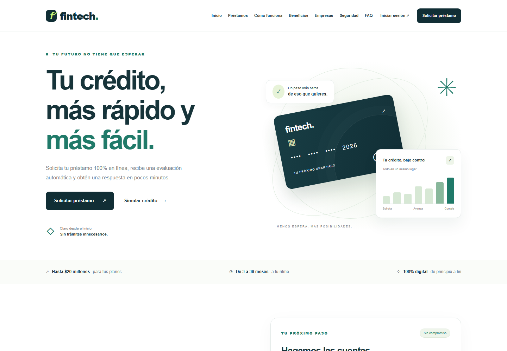
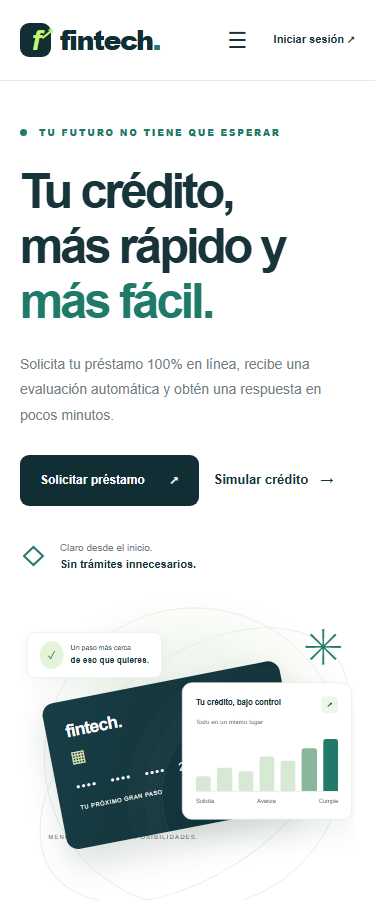
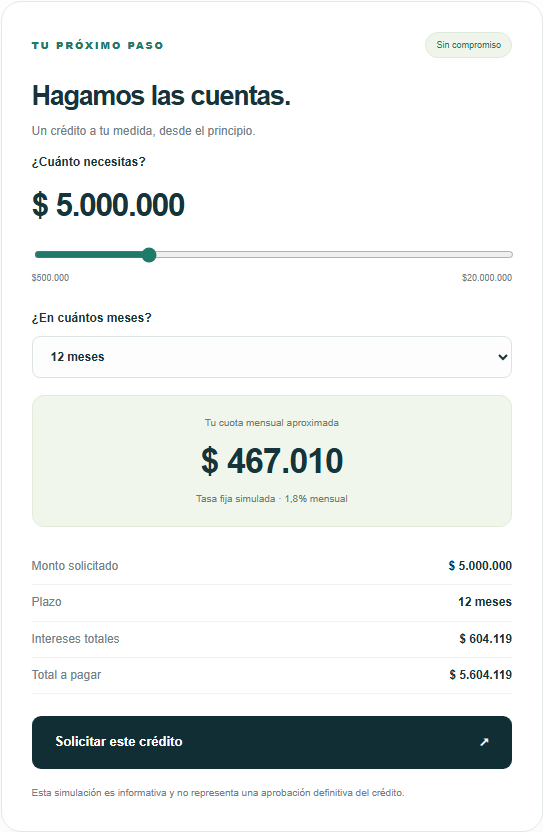
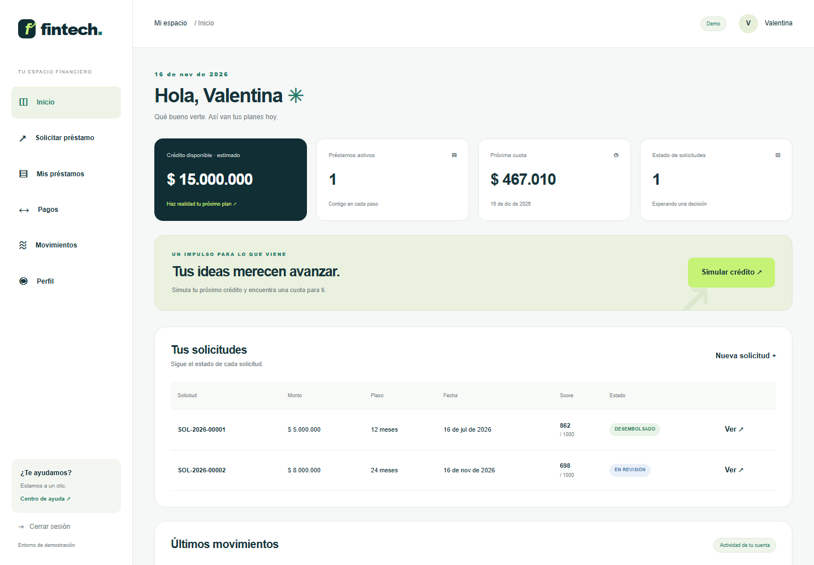
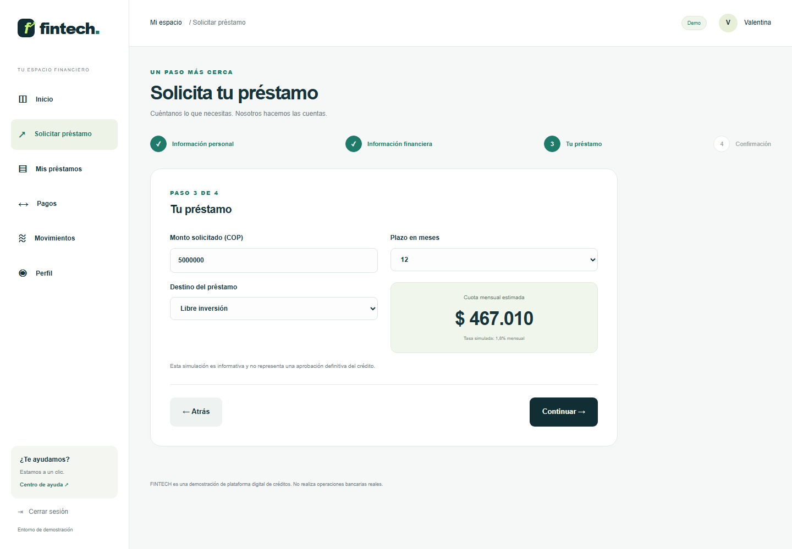
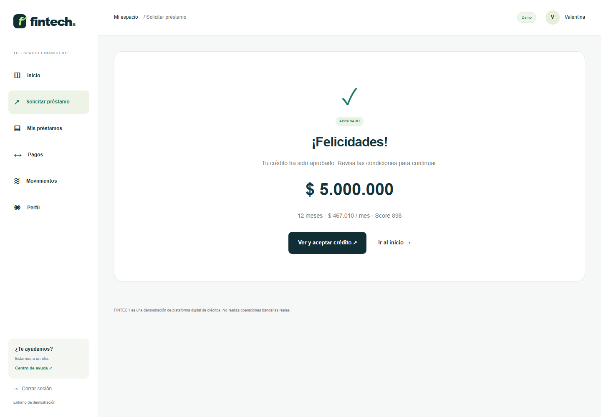
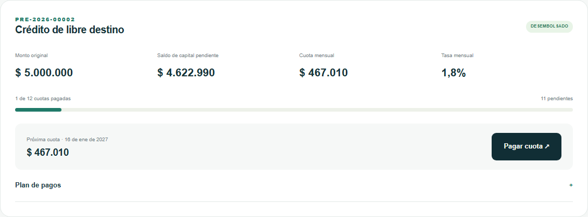
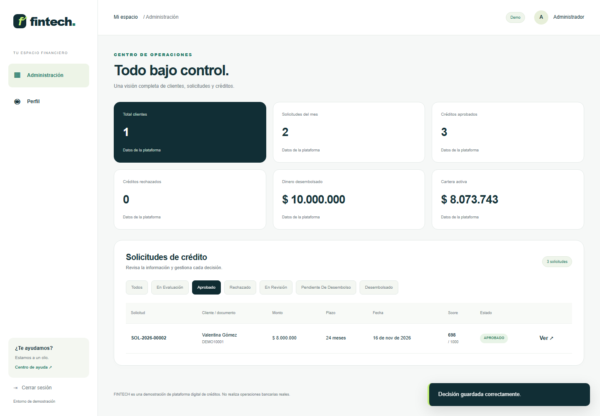

# Evidencias de FINTECH

Capturas de la demostración ejecutada en Chrome con cuentas y datos ficticios. Consulta el [README](../README.md) para repetir el recorrido.

## 1. Inicio en escritorio

La portada presenta la propuesta y permite iniciar una solicitud, entrar a una cuenta o ir al simulador.

## 2. Inicio en móvil

La página adapta la navegación y las acciones principales a un ancho de 375 píxeles.

## 3. Simulador de crédito

Para $5.000.000 COP a 12 meses, el simulador muestra una cuota de $467.010 COP con una tasa ilustrativa del 1,8 % mensual.

## 4. Panel del cliente

La cuenta de demostración muestra la próxima cuota, los préstamos activos y el estado de las solicitudes.

## 5. Configuración de la solicitud

En el tercer paso el cliente elige el monto, el plazo y el destino del crédito. El formulario recalcula la cuota al ajustar el monto o el plazo.

## 6. Resultado de la evaluación

La solicitud de prueba de $5.000.000 COP a 12 meses obtuvo 898 puntos y quedó aprobada. El cliente puede revisar y aceptar las condiciones.

## 7. Desembolso y primer pago

Tras simular el desembolso y pagar la primera cuota, el nuevo crédito muestra 1 de 12 cuotas pagadas, 11 pendientes y un saldo de capital de $4.622.990 COP.

## 8. Panel del administrador

El filtro Aprobado muestra una solicitud que estaba en revisión y que pasó a aprobada después de guardar la decisión. Los indicadores reflejan los movimientos del navegador de prueba.
